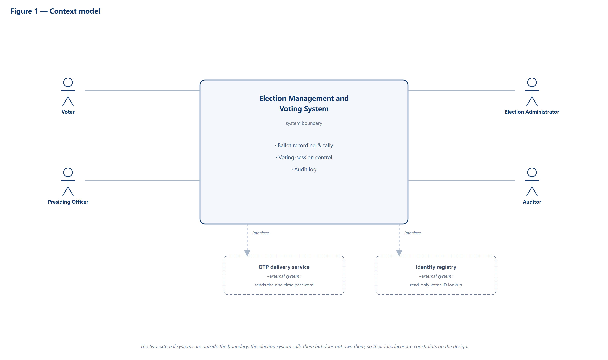
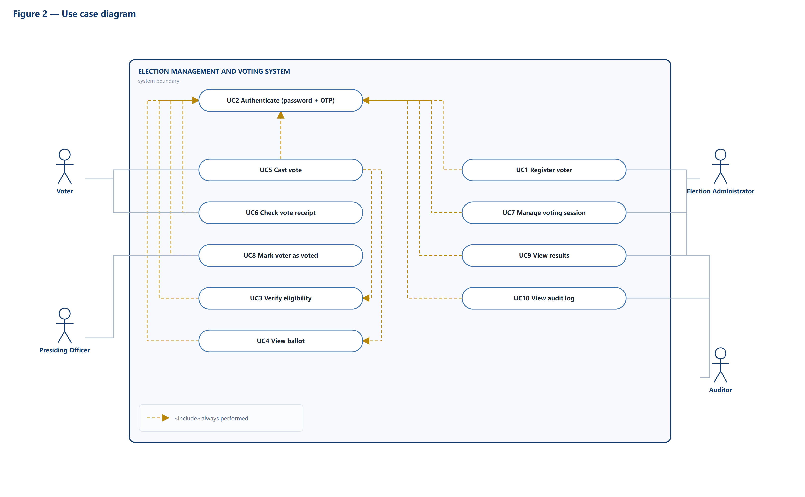
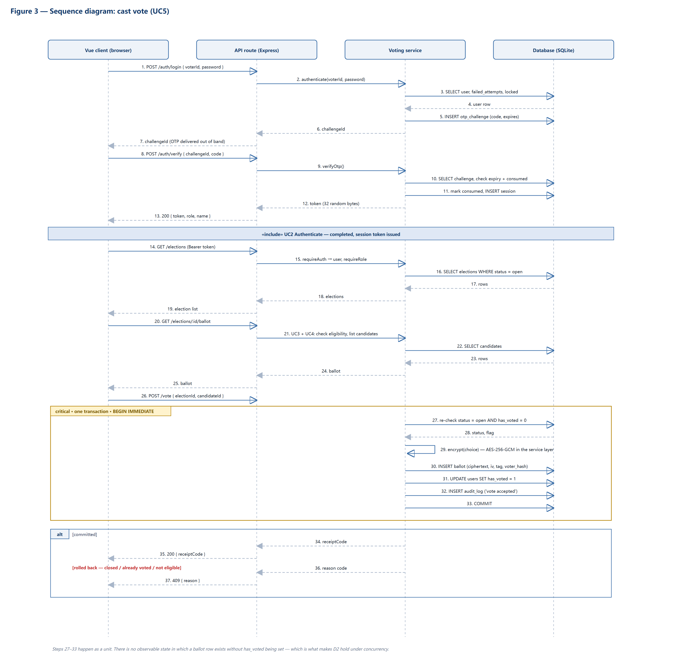
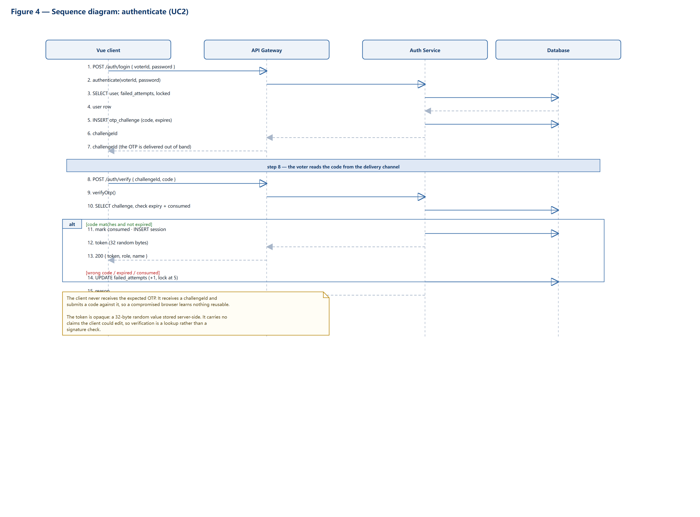
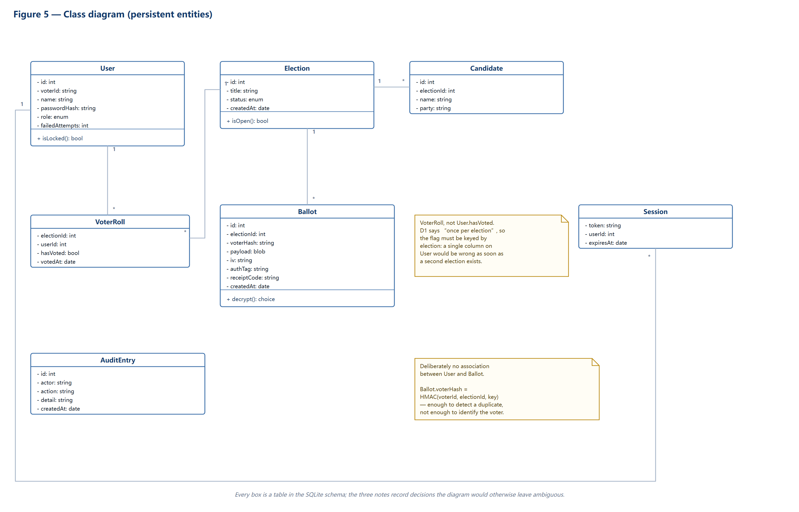
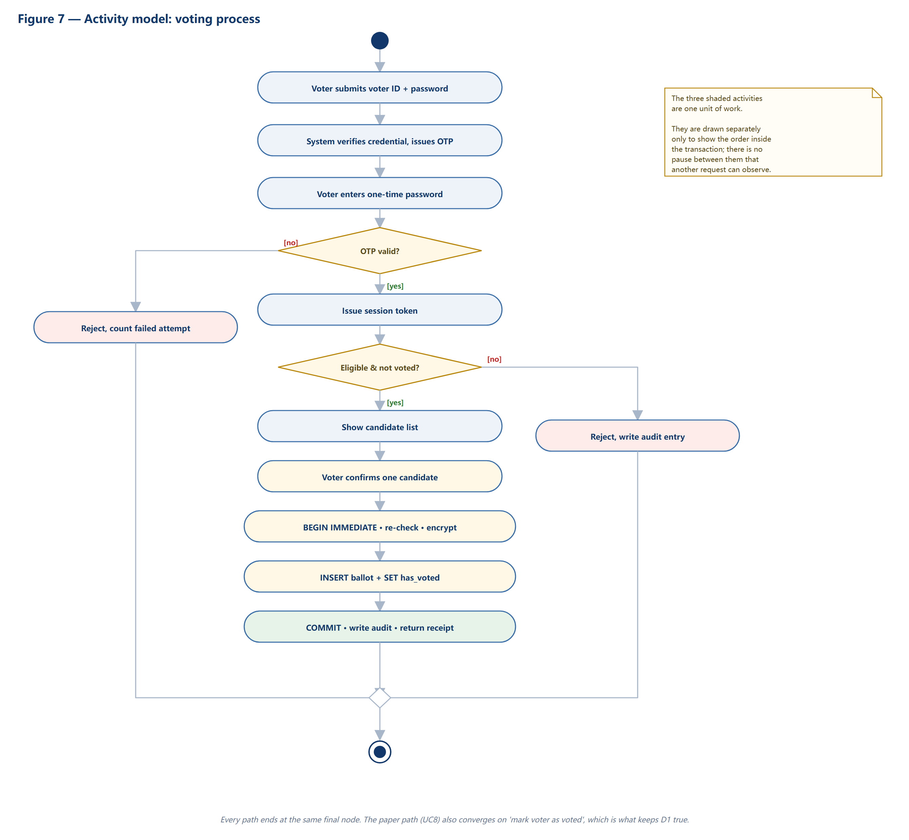

# 2 · System Modeling — Election Management and Voting System

> **中文摘要**
> 本文对应 Lecture 5（系统建模），按四类模型组织：**上下文模型**（系统边界）、**交互模型**
> （用例图 + 两张顺序图）、**结构模型**（类图）、**行为模型**（状态图 + 活动图）。
>
> 建模上的三个要点：
> 1. **认证被抽成独立用例 `UC2`，被所有涉及选票的用例 `«include»`** —— 这样"认证策略"只在一处定义。
> 2. **`«include»` 是「总是执行」**，所以"投片"一定包含"验证资格"和"查看选票"，不是可选的。
> 3. **顺序图里「写入加密选票」与「标记已投票」必须在同一个原子步骤内**，
>    否则两步之间出现间隙就能投两次票（这就是 logbook 里记录的那个难点）。

## 2.1 Context model



The system boundary separates what the election system owns from what it merely talks to. Two
external systems are shown because they impose interfaces the design cannot ignore:

| External system | Interface | Why it is outside |
|---|---|---|
| OTP delivery service | Outbound HTTPS call carrying a phone number and a code | The organisation already operates it; re-implementing it would duplicate a controlled service |
| Identity registry | Read-only lookup of voter ID → registered name | Owned by a different authority; the election system must not become a second source of identity |

Everything inside the boundary — elections, ballots, the tally, the audit log — is the system's
responsibility. The actors are the four roles defined in `01-requirements.md`.

## 2.2 Use case diagram



| ID | Use case | Primary actor |
|---|---|---|
| UC1 | Register voter | Administrator |
| UC2 | Authenticate (password + OTP) | *(included)* |
| UC3 | Verify eligibility | *(included)* |
| UC4 | View ballot | *(included)* |
| UC5 | Cast vote | Voter |
| UC6 | Check vote receipt | Voter |
| UC7 | Open voting session | Administrator |
| UC8 | Close voting session | Administrator |
| UC9 | Mark voter as voted | Presiding Officer |
| UC10 | Manage elections | Administrator |
| UC11 | Manage candidates | Administrator |
| UC12 | Tally results | Administrator |
| UC13 | View results | Auditor, Administrator |
| UC14 | View audit log | Auditor |

### The include relationships, and why they matter

`«include»` means the base use case **always** performs the included one. It is not an optional
extension — that would be `«extend»`. In this model:

- `UC5 Cast vote` includes `UC2`, `UC3` and `UC4`. A ballot cannot be accepted without an
  authenticated session, a positive eligibility check, and a displayed candidate list.
- `UC6`–`UC14` each include `UC2`. Every action that touches a ballot, a session or a count is
  authenticated, and the rule is stated once in `UC2` rather than repeated fourteen times.
- `UC3` and `UC4` are **not** associated with an actor. They are reached only through an including
  use case. Associating them directly with the Voter would misrepresent the model: a voter cannot
  "verify eligibility" as an action in its own right.

### Use case description — UC5 Cast vote

| Field | Content |
|---|---|
| **System** | Election Management and Voting System |
| **Use case** | Cast vote |
| **Actors** | Voter (primary); OTP delivery service (supporting) |
| **Preconditions** | The voter is authenticated (UC2). The voting session is open. The voter is assigned to the election and has not already voted. |
| **Stimulus** | The voter confirms a single candidate selection. |
| **Response** | The system records an encrypted ballot, marks the voter as having voted, writes an audit entry, and returns a receipt code. |
| **Postconditions** | Exactly one additional ballot exists for the election, and the voter can no longer vote in it. D2 holds: accepted ballots ≤ voters marked as voted. |
| **Exceptions** | *Not eligible* → rejected, nothing written. *Already voted* → rejected. *Session closed* → rejected. *Concurrent submission from the same voter* → the second attempt is rejected by the transaction, not by a UI check. |

### Use case description — UC13 View results

| Field | Content |
|---|---|
| **System** | Election Management and Voting System |
| **Use case** | View results |
| **Actors** | Auditor, Administrator |
| **Preconditions** | The actor is authenticated and holds the auditor or administrator role. The session is closed (D4). |
| **Stimulus** | The actor requests the result for an election. |
| **Response** | The system returns the per-candidate count, the number of ballots accepted, and the number of voters marked as voted, so the two totals can be compared. |
| **Postconditions** | An audit entry records who viewed the result and when. |
| **Exceptions** | *Session still open* → refused, because a partial count is an influence channel (D4). *Unauthenticated* → refused. |

### Use case description — UC9 Mark voter as voted

| Field | Content |
|---|---|
| **System** | Election Management and Voting System |
| **Use case** | Mark voter as voted |
| **Actors** | Presiding Officer |
| **Preconditions** | The officer is authenticated. The session is open. The voter has not already voted. |
| **Stimulus** | The officer records that a voter has voted on paper. |
| **Response** | The system sets the voted flag and writes an audit entry. **No ballot is created.** |
| **Postconditions** | The voter's single-vote right is consumed. Accepted ballots remain ≤ voters marked as voted. |
| **Exceptions** | *Voter already voted* → refused. This is the case that keeps D1 true when paper and electronic voting run side by side. |

## 2.3 Interaction model — sequence diagram: Cast vote



Reading the diagram:

1. **Steps 1–7 are `UC2` running.** The voter submits a credential, the gateway issues an OTP
   challenge, the voter returns the code, and a session token is issued. The band marks where the
   included use case ends; every later message travels on that token.
2. **Steps 9–11 are `UC3` and `UC4`.** Eligibility is checked and the candidate list is returned.
3. **Step 14 is the critical one.** Inside a single `BEGIN IMMEDIATE` transaction the service
   (a) re-checks the session is open, (b) re-checks the voter has not voted, (c) writes the
   encrypted ballot, (d) sets `has_voted`, and (e) commits. Everything happens or nothing does.
4. **The `alt` fragment shows the two outcomes.** On success a receipt code is returned. On failure
   nothing is written and the voter is told why — a rejected ballot must never leave a partial row.

The reason step 14 is a single step and not two is the subject of §2.6.

## 2.4 Interaction model — sequence diagram: Authenticate



Two design points are visible:

- **The OTP is verified server-side only.** The client never receives the expected code; it receives
  a challenge ID and submits a code against it. A compromised client learns nothing reusable.
- **The session token is opaque.** It is a random 32-byte value stored server-side; it carries no
  claims the client could edit. Verification is a lookup, not a signature check, which keeps the
  implementation small at the cost of a database read per request.

## 2.5 Structural model — class diagram



The important part of this model is the **absence** of a relationship: there is no association
between `Ballot` and `User`. `Ballot` carries `voterHash`, a keyed hash of the voter ID and the
election ID, which:
- lets the system detect a duplicate ballot for the same voter,
- does **not** let anyone read the voter's identity from the ballots table,
- cannot be reversed to a voter ID without the application key.

`VoterRoll.hasVoted` is the flag that actually enforces the single-vote rule, and it is written in
the same transaction as the `Ballot` row. `VoterRoll` is keyed by `(electionId, userId)` rather than
being a column on `User`, because D1 says *once per election*: a single flag on `User` would be
wrong as soon as a second election exists. The two facts — "a ballot exists" and "this voter has
voted in this election" — are therefore always consistent.

## 2.6 Behavioural model — state diagram


Two state machines matter:

**Election lifecycle.** `Draft → Open → Closed → Published`. The transition `Open → Closed` is the
only way to reach a publishable state, which is how D4 ("no partial counts") is enforced structurally
rather than by a permission check that someone could forget.

**Ballot lifecycle.** `Unsubmitted → Encrypting → Committed | Rejected`. There is no
`Committed → anything` transition: D3 says an accepted vote cannot be amended or deleted, so the
model has no edge for it. A state machine that simply cannot express "edit a committed ballot" is a
stronger guarantee than a rule in a service method.

## 2.7 Behavioural model — activity model



The activity model shows the voting process end to end, including the paper path that returns
through `UC9`. Note the merge before the final decision: **both** paths converge on "mark voter as
voted", which is what keeps D1 true when a polling station runs both paper and electronic voting on
the same day.

## 2.8 The design problem this modelling exposed

While drawing the cast-vote sequence diagram, the first version placed the ballot write and the
`has_voted` update in two separate steps:

```
15. write encrypted ballot
16. set has_voted = true
```

Modelling the messages in order made the gap visible. Between step 15 and step 16 the voter is
authenticated, eligible, and **not yet marked as voted**, so a second request in that window is
accepted. Two ballots are written for one voter, and D2 is broken.

The fix was to collapse both writes into one transaction (step 14 in the final diagram). This is why
the sequence diagram in this document has one step where a naive design would have two: the diagram
is where the defect was found, before any code was written. The corresponding regression test is T7
in `docs/04-testing.md`.
