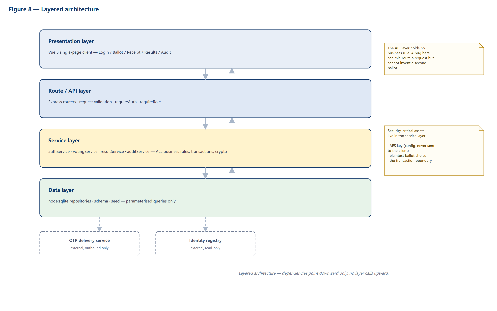

# 3 · Architectural Design — Election Management and Voting System

> **中文摘要**
> 本文对应 Lecture 6（架构设计）。选了**分层架构**，理由是 NF2/NF3/NF4（保密性、匿名性、可用性）
> 是架构级属性——它们不可能靠后期在业务代码里加几行判断补上。
>
> 关键决定有三个：
> 1. **分层**：路由层 / 服务层 / 数据访问层 / 基础设施层，加密与事务只在服务层出现，
>    路由层不写业务逻辑。
> 2. **选票内容加密存放在内层**，外层即使被攻破也读不到明文（这是 L6 讲的"安全资产放内层"）。
> 3. **事务边界由服务层持有**，而不是路由层——否则"原子性"会随调用方而变。

## 3.1 Architectural style: layered



The system is a three-tier web application internally organised as four layers:

| Layer | Contents | Rules |
|---|---|---|
| **Presentation** | Vue 3 single-page client | Knows only the HTTP API. Holds a token in memory; never stores a ballot choice beyond the request. |
| **Route / API** | Express routers, request validation, role guards | Translates HTTP to a service call. **Contains no business rule.** |
| **Service** | `authService`, `votingService`, `resultService`, `auditService` | Owns every business rule and every transaction boundary. This is the only layer that touches the crypto and transaction primitives. |
| **Data** | `node:sqlite` repositories, schema, seed | Provides parameterised queries only. Does not decide eligibility or ordering. |

Why layered rather than the alternatives considered:

| Alternative | Why it was not chosen |
|---|---|
| **Client–server (thin server)** | Would put eligibility and single-vote checks in the browser, where they can be bypassed. F4 and D1 must be enforced server-side. |
| **Repository (shared data store, peers)** | The core risk here is a *rule* (one vote, no edit), not data sharing between peers. A central store with peer components gives no place to put the transaction. |
| **Microservices** | Correct eventual shape for a national system, wrong for one cohort's scope: it moves the atomicity problem to a distributed transaction, which is strictly harder. Documented as evolution work in `05-evolution.md`. |
| **Monolith without layers** | Fastest to write and impossible to test per requirement. The traceability table in `01-requirements.md` would have nowhere to point. |

### Where the security-critical assets sit

Lecture 6's guidance — put critical assets in the inner layers so that a compromised outer layer
does not expose them — maps directly onto this design:

- **The AES key** exists only in `config.js`, read by the service layer. It is never sent to the
  client and never appears in a query log.
- **Plaintext ballot choices** exist only inside `votingService.castBallot`, between decryption of
  the request and encryption for storage. They are not returned by any endpoint.
- **The `has_voted` invariant** is enforced inside the data layer's transaction, so a route-level bug
  cannot produce a second ballot.

If the presentation layer is fully compromised, an attacker can act as any authenticated user but
still cannot read a stored ballot or break the single-vote rule.

## 3.2 Component responsibilities

```
web/                     Vue 3 + Vite, no router
  App.vue                view switching: login → vote → receipt → results → audit
  api.js                 one fetch wrapper, attaches the bearer token
  views/LoginView.vue    two-step credential + OTP form
  views/BallotView.vue   election list, candidate list, confirm
  views/ReceiptView.vue  receipt code display and verification
  views/ResultsView.vue  per-candidate count + turnout
  views/AuditView.vue    append-only audit entries

server/
  src/index.js           app wiring, static hosting of the built client
  src/db.js              schema creation, seed data, transaction helper
  src/routes/auth.js     POST /login, POST /verify, POST /logout
  src/routes/admin.js    POST /admin/elections, /:id/candidates, /:id/open, /:id/close
  src/routes/elections.js GET elections, GET ballot
  src/routes/vote.js     POST /vote, GET /receipt/:code
  src/routes/results.js  GET /results/:electionId
  src/routes/audit.js    GET /audit
  src/services/*.js      the four services above
  src/middleware/auth.js requireAuth, requireRole
```

## 3.3 Data model

```sql
users(id, voter_id UNIQUE, name, password_hash, role, failed_attempts)
elections(id, title, status, created_at)          -- draft | open | closed
candidates(id, election_id, name, party)
voter_roll(election_id, user_id, has_voted, voted_at)   -- PK (election_id, user_id)
ballots(id, election_id, voter_hash, payload, iv, tag, receipt_code, created_at)
audit_log(id, actor, action, detail, created_at)
sessions(token, user_id, expires_at)
otp_challenges(id, user_id, code, expires_at, consumed)
```

Two design notes that are load-bearing:

1. **`ballots` has no `user_id` column.** It has `voter_hash`, a keyed hash of voter ID + election ID.
   This is what makes NF3 (identity and choice in separate records sharing no direct key) true at the
   storage level rather than only by convention.
2. **`voter_roll.has_voted` is the enforcement point for D1**, not the existence of a ballot row.
   It is keyed by `(election_id, user_id)` because D1 is *once per election* — a single flag on
   `users` was the first design and it was wrong for any deployment with two elections. The
   officer's paper-path use case (UC8) sets this flag without creating a ballot, and the invariant
   D2 (accepted ballots ≤ voters marked as voted) still holds, per election.

## 3.4 The transaction decision

```js
// votingService.castBallot — the whole body runs inside one IMMEDIATE transaction
db.exec('BEGIN IMMEDIATE');
  election = readElection(electionId);           // must be 'open'
  roll     = readRoll(electionId, userId);       // must exist and has_voted = 0
  candidate= readCandidate(candidateId);         // must belong to this election
  insertBallot(encrypt(choice));                 // ciphertext only
  updateRoll(electionId, userId, has_voted = 1);
  insertAudit('vote.accepted');
db.exec('COMMIT');
```

The roll lookup is why the flag had to move off `users`: the `WHERE` clause needs the election
id, and a global `has_voted` column has no place to put it.

`BEGIN IMMEDIATE` takes the write lock up front rather than on first write. With the default
deferred transaction, two concurrent requests can both read `has_voted = false` and both proceed to
the insert, one then failing at commit — which produces an error but, worse in a naive schema, can
leave an orphan ballot. Taking the lock at `BEGIN` serialises the read-check-write sequence.

This is the architectural consequence of the modelling problem described in
`02-system-modeling.md` §2.8. The `ballots(election_id, voter_hash)` unique index is a second,
independent guard: even a service bug cannot produce a duplicate row.

## 3.5 Architectural decisions and their trade-offs

| Decision | Chosen because | Accepted cost |
|---|---|---|
| Server-side sessions (opaque token in a table) rather than signed JWTs | Revocation is a row delete; no key rotation to manage | One indexed read per request |
| `node:sqlite` instead of a database server | Zero external services to run for a demo; the SQL is portable to PostgreSQL later | Single-writer; not suitable beyond one node (see §3.6) |
| AES-256-GCM per ballot | Confidentiality **and** tamper detection in one primitive; a modified ciphertext fails the tag check | Key management is now a real operational concern, not a code concern |
| One Express process serving both the API and the built client | No CORS configuration to get wrong, one origin to reason about | Static and dynamic traffic share a process |
| No router in the Vue client | Five views and one linear flow; a router adds a dependency and a concept for no benefit | Adding deep links later needs a small refactor |

## 3.6 What this architecture does not claim

Being explicit about the limits is part of the design:

- **Single node.** SQLite gives one writer. The 200-concurrent-voter target (NF1) is met on one node
  for this workload; a national election would need a replicated database and would move the
  single-vote constraint into the database's own transaction manager.
- **The administrator is trusted for key custody.** The AES key lives in the application process. An
  administrator with server access can decrypt ballots. Removing that trust requires a
  threshold-cryptography scheme, which is out of scope but named in `05-evolution.md`.
- **No end-to-end voter-verifiable cryptography.** The receipt proves *the system recorded a vote*,
  not *the vote was included in the tally*. A real end-to-end scheme needs a published bulletin
  board with a verifiable mix-net.
- **No offline mode.** A polling station losing connectivity cannot vote. The paper path (UC9) is the
  documented fallback, which is why UC9 exists at all.

Stating these prevents the report from overclaiming, which is the failure mode Lecture 6 warns about
when architectural choices are presented without their trade-offs.
